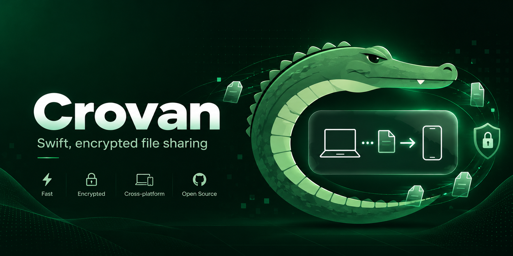
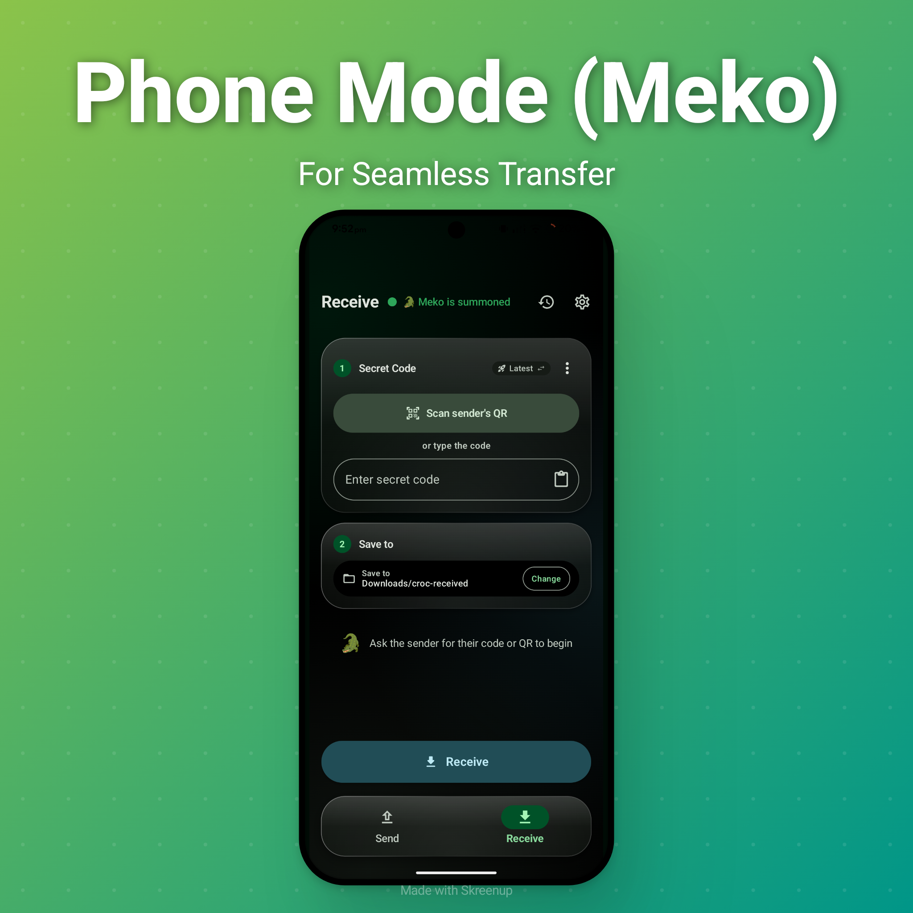
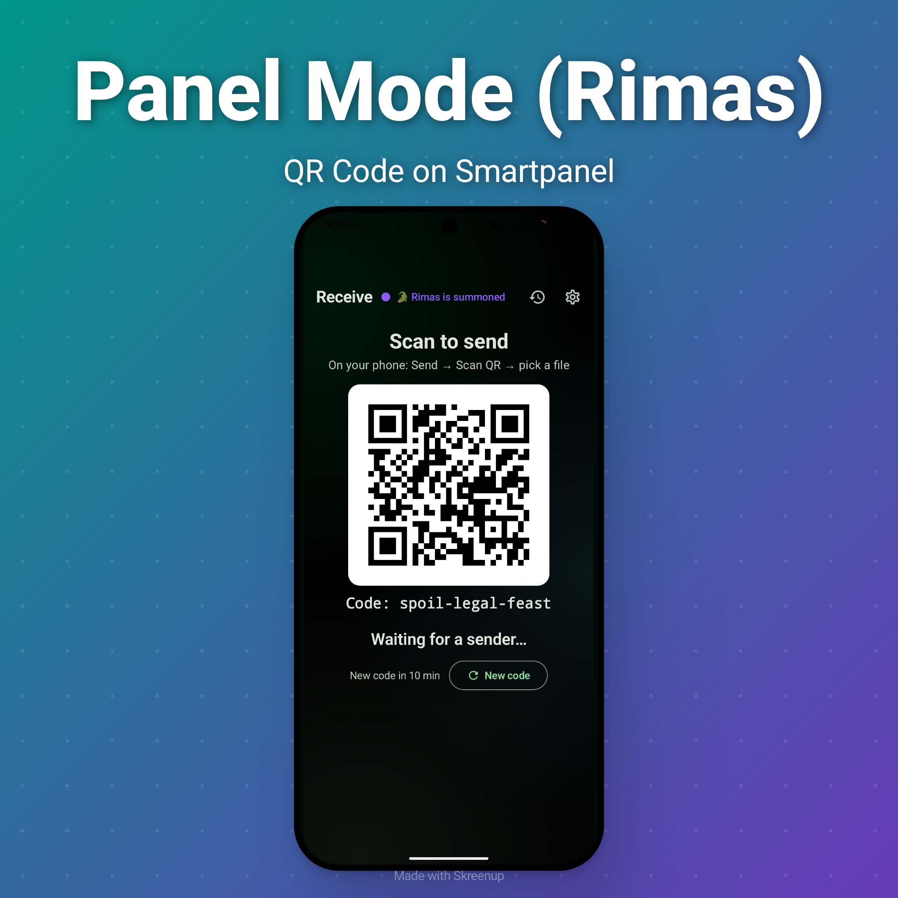
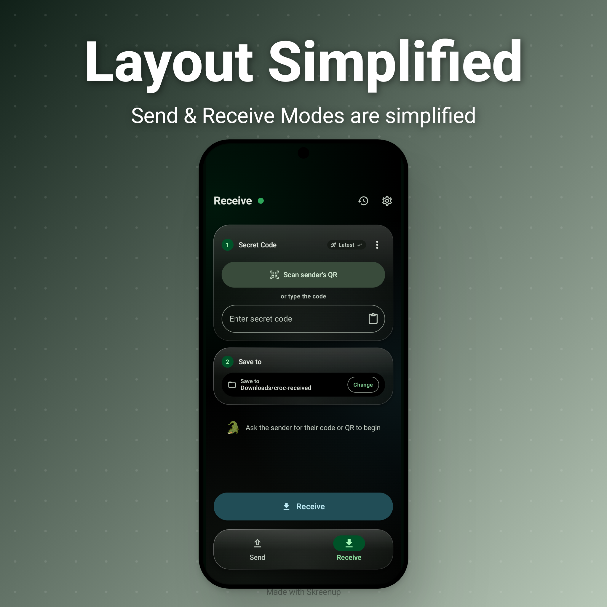
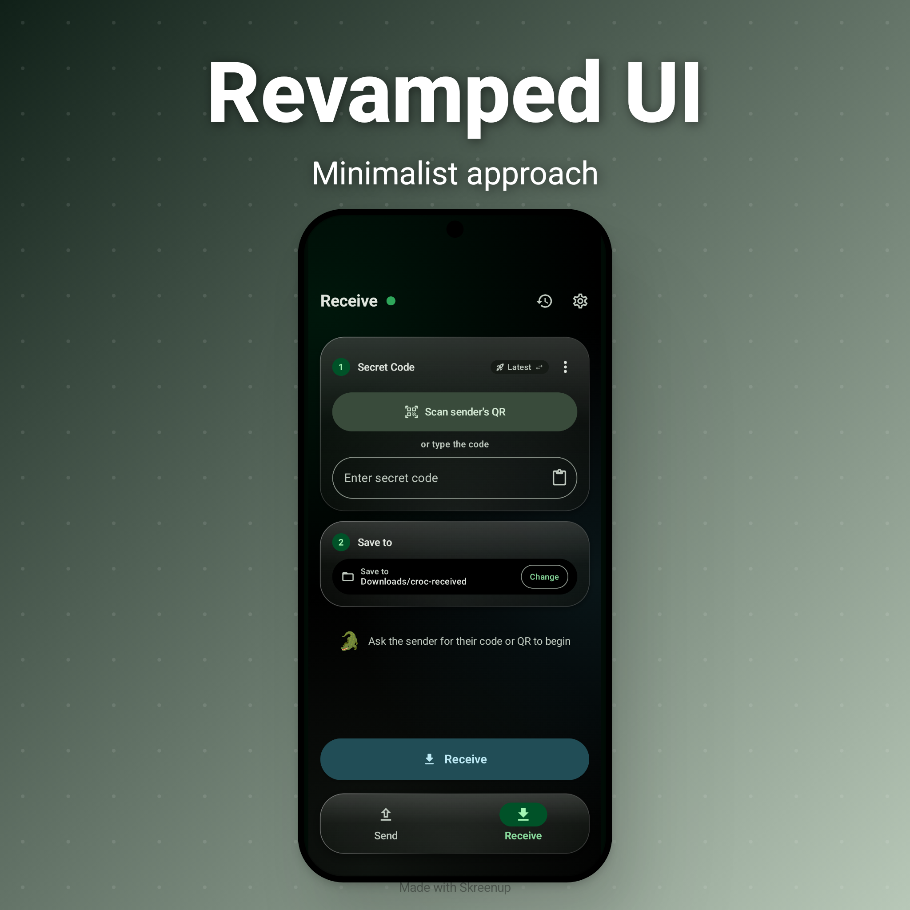

<p align="center">
  
</p>

<h1 align="center">🐊 Crovan</h1>

<p align="center">
  <strong>Minimalist file sharing across devices.</strong><br>
  Kotlin · Jetpack Compose · Material 3
</p>

<p align="center"><a href="https://github.com/Dray-Ashcroft/Crovan/releases"><strong>Download the APK</strong></a></p>

<p align="center">
  <a href="#-about">About</a> ·
  <a href="#-screenshots">Screenshots</a> ·
  <a href="#-two-modes">Modes</a> ·
  <a href="#-features">Features</a> ·
  <a href="#-whats-new-rc-iv-delta">What's new</a> ·
  <a href="#-install">Install</a> ·
  <a href="#%EF%B8%8F-building">Building</a> ·
  <a href="#-credits">Credits</a> ·
  <a href="#-license">License</a>
</p>

---

<p align="center"><em>Project dedicated to Lord Vishnu</em></p>

---

## ✦ About

Crovan is an Android app for sending files, folders and text between devices with [croc](https://github.com/schollz/croc). Both sides need only a short code or a QR scan, with no account and no cable, and the transfer is end-to-end encrypted.

- **Android client for croc**, built on the Android croc client by [Dking08](https://github.com/Dking08)
- **This fork adds** a new look, a crocodile mascot with animations, and a smart-panel mode for classrooms
- **Formerly Kroc-Sauria**: renamed to Crovan in RC IV "Delta"

---

## 📱 Screenshots

<table width="100%">
  <tr>
    <td width="50%" align="center">
      
      <br><sub><b>Phone mode (Meko)</b></sub>
    </td>
    <td width="50%" align="center">
      
      <br><sub><b>Panel mode (Rimas)</b></sub>
    </td>
  </tr>
  <tr>
    <td width="50%" align="center">
      
      <br><sub><b>Send</b></sub>
    </td>
    <td width="50%" align="center">
      
      <br><sub><b>Receive</b></sub>
    </td>
  </tr>
</table>

---

## 🔀 Two Modes

One app, two modes. A small **mode dot** beside the screen title shows which one is on.

| Mode | For | What it does |
|:--|:--|:--|
| 🟢 **Meko** | Your phone | Full **Send** and **Receive**. Switch between them instantly, or swipe. |
| 🟣 **Rimas** | A tablet or classroom smart panel | A **receive-only** screen that waits with a large QR code and the code beneath it. Scan it from a phone and send. |

- **Switching mode:** hold the dot for about a second. A single tap does nothing.
- **Self-refreshing QR:** Rimas gets a fresh code every 10 minutes, after every transfer, and whenever the connection drops, so the QR on screen always works. The screen shows when the next code is due, and the last file received.
- **Sending to a panel:** on the phone, open Send, tap **Scan panel QR**, then pick a file.

---

## ✦ Features

| | Feature |
|:-:|:--|
| 📤 | **Send** files, folders or text (including clipboard text), in clear numbered steps |
| 📥 | **Receive** by scanning the sender's QR or typing the code; files go to `Downloads/croc-received` unless you choose another folder |
| 📷 | **QR pairing**: show a QR to send, or scan one to receive. The scanner reads QR codes on screens reliably. |
| 🗄️ | **Store mode**: upload encrypted files for later pickup (see below) |
| 🔐 | **Saved code phrases** in Settings |
| 🕘 | **History** ("Recents") with filters for All, Sent, Received, Stored and Favorites |
| 🔁 | **Two croc engines**: the latest, plus a legacy one for older croc versions. The app offers legacy mode when it detects an older croc version. |
| 🌐 | **Transport choice**: Auto (direct, DERP or relay), DERP only, or relay only, with custom relay address and password |
| 🔗 | **Share sheet** and `croc://` deep links |
| 📖 | **Guide & Troubleshooting** inside the app |
| 🌍 | **Languages**: English, Español, हिन्दी, 简体中文 and 繁體中文 |
| 🎨 | A crocodile mascot that animates while devices pair, and an Android themed icon |

### 🗄️ Store Mode

Choose **Store** instead of **Direct** on the Send screen to upload an encrypted copy that the receiver can pick up later.

- Files are encrypted on your device. By default they expire after 24 hours or one verified download; the lifetime and download limit are set in Settings.
- Share the result as a **browser link**, a **CLI token** (`croc <token>`) or a **QR code**.
- **Revoke** a stored transfer at any time to delete it from the storage server at once.
- Uses the croc store at getcroc.com by default; a **custom store URL** can be set. Needs the latest croc engine (v11 or newer).

### ⚙️ Advanced Settings

Relay address and password · data transport · PAKE curve · hash algorithm · disable compression · multicast address · receive folder · theme · app language

---

## ✦ What's New: RC IV "Delta"

- 🟣 **Rimas panel mode**: a receive-only screen with a large, self-refreshing QR
- 🟢 **Mode dot**: hold to switch Meko ⇄ Rimas
- 📷 **Scan the panel's QR** from the Send screen; the scanner reads screens reliably
- 🧭 **Redesigned Send and Receive** in clear ①②③ steps; Quick mode removed
- ⚡ **Instant Send ⇄ Receive switching** (swipe too), even on smart panels
- 🎨 **New name and icon**: Kroc-Sauria is now Crovan

---

## 📲 Install

Download the signed APK from [Releases](https://github.com/Dray-Ashcroft/Crovan/releases).

| Requirement | |
|:--|:--|
| Android | 8.0 or newer |
| Processor | **64-bit ARM (arm64-v8a)**. The croc engine is built for ARM64 only. |

**Updating from an older version:** Delta is signed with the same key as Triton.

- **From Triton:** install the Delta APK directly. It updates over Triton and keeps your history and settings.
- **From Dawn or Requiem:** uninstall the old version first, because the signing key changed in Triton.

**Permissions**

| Permission | Used for |
|:--|:--|
| Camera | Scanning QR codes |
| Notifications and foreground service | Keeping a transfer running and showing its progress |
| Network, Wi-Fi and multicast state | Transfers and local-network discovery |
| Storage and media access | Reading files to send and saving received files |

---

## 🛠️ Building

You need JDK 17, the Go version named in `third_party/croc-src/go.mod`, and Gradle 8.9.

```bash
gradle assembleDebug
```

- **Engines:** the croc source is vendored in `third_party/`, with the current engine (`v11.5.2`) and a frozen legacy engine (`v10.6.0`). Both are built into the app for arm64.
- **CI:** a debug APK is built on every push to `master`. The signed release APK is built by hand from the Actions tab.
- **Croc updates:** a weekly workflow checks for a new croc release and updates the vendored source.
- **Reproducible build:** the `reproducible-build/` folder has a Docker setup that mirrors F-Droid's build server.

Contributions are welcome; please read [CONTRIBUTING.md](CONTRIBUTING.md) first. Translations are managed through Crowdin.

---

## ⚙️ Technology

| | |
|:--|:--|
| **UI** | Kotlin · Jetpack Compose · Material 3 |
| **App** | Room (history) · DataStore (settings) · CameraX and ZXing (QR) |
| **Engine** | croc, written in Go |
| **Source** | GitHub · Codeberg |
| **Implementation** | Claude Opus 5.5 · OpenAI GPT 5.7 Luna |

---

## ✦ Credits

- **Croc engine**: [schollz](https://github.com/schollz/croc) (MIT licence)
- **Original Android client**: Dastageer Siddiqui ([Dking08](https://github.com/Dking08))
- **Crovan design & animation**: this fork
- **Third-party code** in the croc engine, such as Tailcat and tailscale.com (BSD 3-Clause): see `third_party/croc-src/THIRD_PARTY_NOTICES.md`

---

## 📜 License

Crovan is licensed under the **GNU General Public License v3.0** (see [LICENSE](LICENSE)). The bundled croc source in `third_party/` keeps its own **MIT** licence.

---

<p align="center">
  <strong>Crovan 🐊</strong><br>
  <sub>Forked from the Android Croc client · Powered by croc</sub>
</p>
