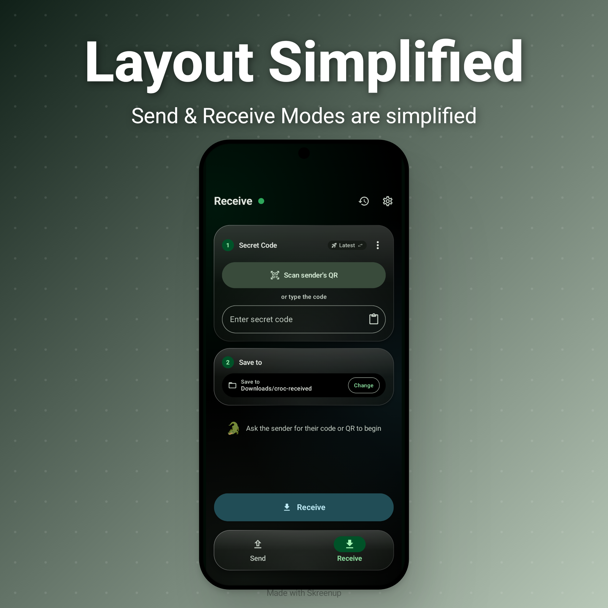
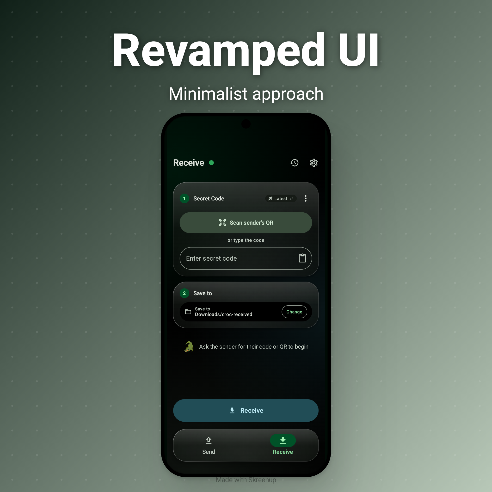
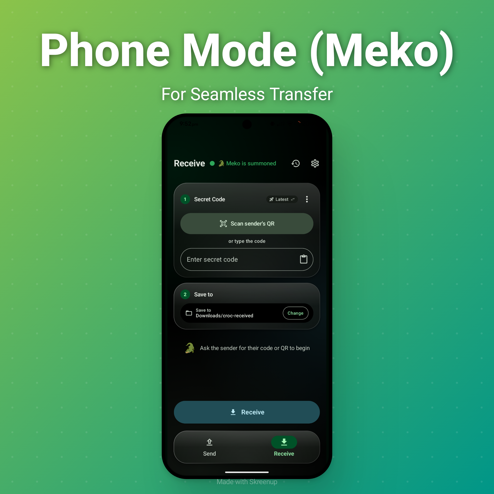
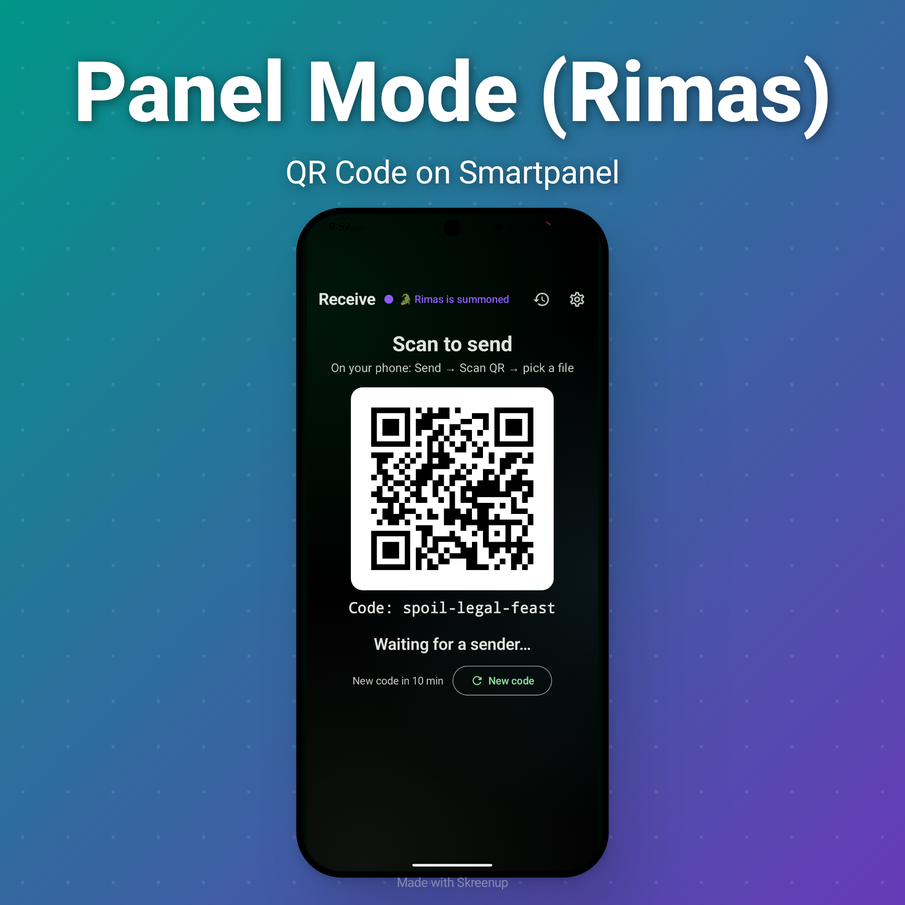

  

<h1 align="center">Crovan</h1>

  <strong>Minimalist file sharing across devices.</strong> 
  Kotlin · Jetpack Compose · Material 3

---

>
<em> Project Dedicated to Lord Vishnu</em>

---

## ✦ About

- Android client for [Croc](https://github.com/schollz/croc) file transfers
- Fork of the Android Croc client by [Dking08](https://github.com/Dking08)
- This fork: new look, mascot and animations, plus a smart-panel mode

## ✦ Features

- 📤 Send files, folders and text
- 📱 QR code pairing
- 🔐 Saved transfer codes
- 🕘 Transfer history
- 🔁 Legacy engine fallback for older Croc versions
- 🔗 Share sheet and `croc://` deep links
- 🖥️ Panel mode (Rimas) — smart panels wait with a self-refreshing QR code

## ✦ What's New : RC - IV "Delta"

- 🟣 Rimas panel mode — receive-only screen with a large, self-refreshing QR
- 🟢 Mode dot — hold to switch Meko (phone) ⇄ Rimas (panel)
- 📷 Scan panel QR from the Send screen; scanner reads screens reliably
- 🧭 Redesigned Send and Receive in clear ①②③ steps; Quick mode removed
- ⚡ Instant Send ⇄ Receive switching (swipe too), even on smart panels
- 🎨 New name and icon — Kroc-Sauria is now Crovan

## 📱 Screenshots

  
  &nbsp;
  

  
  &nbsp;
  

## ⚙️ Technology

- **UI** · Kotlin · Jetpack Compose · Material 3
- **Source** · GitHub · Codeberg
- **Implementation** · Claude Sonnet 5.5 · OpenAI 5.6 Luna

## ✦ Credits

- **Croc engine** - [schollz](https://github.com/schollz/croc)
- **Original Android client** - Dastageer Siddiqui ([Dking08](https://github.com/Dking08))
- **Crovan design & animation** - this fork

Licensed under [GPL v3](LICENSE).

---

  <strong>Crovan 🐊</strong> 
  Forked from the Android Croc client · Powered by Croc

